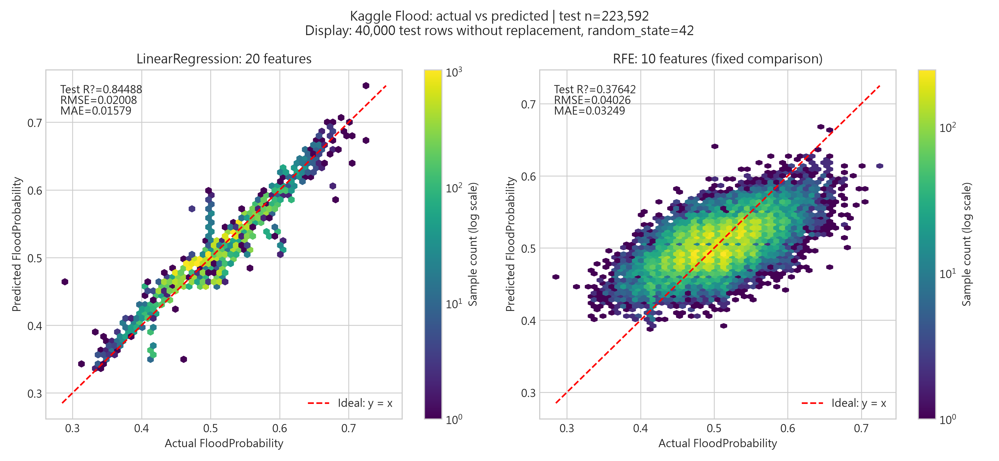
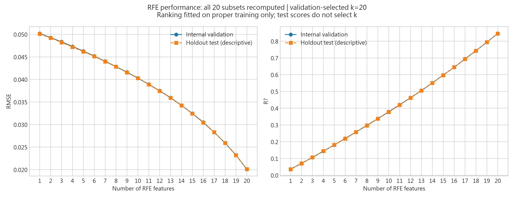
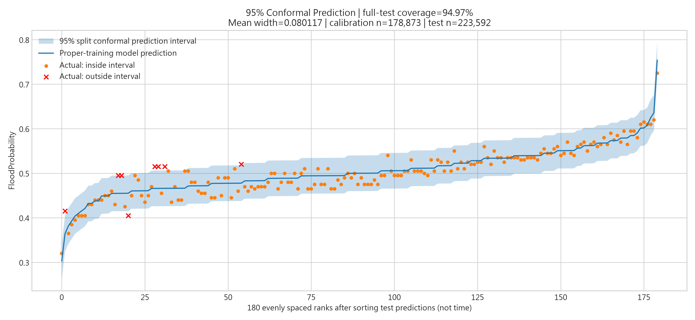

# HW2 Flood Prediction：模型分析與部署紀錄

官方資料來源：[Kaggle Playground Series S4E5 train.csv](https://www.kaggle.com/competitions/playground-series-s4e5/data?select=train.csv)。使用實際下載的官方競賽資料（該競賽提供合成資料），不是自行編造數值。共 1,117,957 筆、22 欄，排除 id 與 FloodProbability 後為 **20 個原始輸入特徵**。網站保留 50 Startups、Boston Housing 與自訂 CSV 入口。

## 資料下載與重現

1. 登入 Kaggle，至上述官方資料頁，依平台要求接受競賽規則，再下載 train.csv（若下載 ZIP，先解壓縮）。
2. 在專案根目錄建立 datasets/，將原始檔放為 datasets/train.csv；不可改名為 train.csv/train.csv。
3. 安裝專案所需 Python 套件後，從專案根目錄執行 `python flood-prediction/main.py` 可重現運算。本次部署修正沒有執行訓練。

完整 train.csv 與下載 ZIP 不納入 Git；原始資料保留本機。網站只需預先產生的 JS、PNG、JSON/CSV 結果，不需在 Pages 執行 Python。

## 模型與資料切分

使用 sklearn LinearRegression；random_state=42，80% 訓練 894,365 筆、20% 獨立測試 223,592 筆。訓練內再分成 proper training 715,492 筆及內部驗證／校準 178,873 筆。訓練與指標計算使用全部資料，沒有抽樣。

RFE 在 proper training 擬合，完整淘汰順序評估 k=1–20；10 特徵為固定比較基準，不是最佳子集。最新選取順序：

1. `MonsoonIntensity`
2. `Siltation`
3. `RiverManagement`
4. `DamsQuality`
5. `ClimateChange`
6. `PopulationScore`
7. `TopographyDrainage`
8. `Landslides`
9. `Deforestation`
10. `WetlandLoss`

驗證集 RMSE 最小為 k=20。測試曲線僅作描述，不用於選擇 k。

## 實測結果

數值以 model/model_metadata.json、outputs/model_evaluation_metrics.csv 及 outputs/rfe_feature_selection_metrics.csv 為準。

| 模型 | RMSE | MAE | R² | 95% 區間覆蓋率 | 平均區間寬度 |
| --- | ---: | ---: | ---: | ---: | ---: |
| LinearRegression 20 特徵 | 0.02008 | 0.01579 | 0.84488 | 94.97% | 0.08012 |
| RFE 10 特徵 | 0.04026 | 0.03249 | 0.37642 | 94.95% | 0.15501 |

點預測模型使用完整 80% 訓練集。Split Conformal 區間另外使用 proper-training 模型，校準及測試使用同一模型，校準後不重新擬合；殘差分位數採有限樣本修正與 method=higher。覆蓋率是獨立測試集的實測比例，不是每個樣本的個別保證。

本資料中保留 20 特徵比固定 RFE 10 特徵有較低誤差及較高 R²；不能單憑此結果推論特徵具有因果效果或統計顯著性。95% 區間實測覆蓋率接近目標，亦不表示所有迴歸假設均已成立。

## 三張核心圖（300 dpi）

`flood-prediction/outputs/actual_vs_predicted_comparison.png`：LinearRegression 實際值與預測值：20 特徵與 RFE 10 特徵的雙面板 Hexbin 圖；紅虛線為 y=x。

`flood-prediction/outputs/feature_selection_curve.png`：RFE 1–20 特徵的 RMSE 與 R²，並列內部驗證及獨立測試結果；最佳特徵數只由驗證集決定。

`flood-prediction/outputs/prediction_interval_95.png`：95% Split Conformal 預測區間、預測曲線與區間內外實際值；圖中標示完整測試集覆蓋率及平均寬度，橫軸不是時間。

散佈圖只為顯示，使用 RandomState(42).choice(test_rows, 40000, replace=False) 無放回抽樣；所有指標仍使用完整測試集。區間圖依 proper-model 預測排序，取 180 個等間距排名位置顯示；沒有時間序列、分箱平均線或下方直方圖。

完整 RFE 1–20 結果：[RFE CSV](flood-prediction/outputs/rfe_feature_selection_metrics.csv)；模型指標：[模型 CSV](flood-prediction/outputs/model_evaluation_metrics.csv)。資料 SHA-256 與切分、抽樣資訊位於 [metadata](flood-prediction/model/model_metadata.json)。

## 測試與部署狀態（2026-10-27，Asia/Taipei）

- Python：前輪已完成完整運算；本輪只比對 metadata 與兩份 CSV 的所有相關指標、k=1–20 完整性，以及 PNG 解碼和 300 dpi，未重訓或修改成果數據。
- localhost:8000：前輪 HTTP 檢查入口、三個專案與直接引用的本機資源皆為 200；使用者本輪已確認完成 localhost 圖表驗收。這是使用者回報的手動驗收，不是本代理新增的瀏覽器測試。
- 專案切換／CSV：保留既有實作，ml-projects.html、50 Startups 與 Boston Housing 程式未修改。先前代理未能自動操作瀏覽器或讀取 Console；不能將靜態檢查解讀為互動／Console 全面通過。
- GitHub Pages：尚待推送後由使用者手動開啟確認；不可宣稱公開網站已驗證成功。

正式網址：[Flood Prediction](https://porter974-afk.github.io/feature-selection/ml-projects.html?project=flood)。公開驗收請確認三圖可見、三個題目切換、CSV URL 及本機 CSV 匯入，並在 F12 Console／Network 檢查 JavaScript 錯誤、404 與 CDN／CORS 問題。CSV 測試可用專案的 50_Startups.csv；不需點擊訓練。
